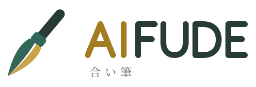

# AIFUDE（合い筆）

<p align="center">
  <picture>
    <source media="(prefers-color-scheme: dark)" srcset="docs/images/logo-dark.svg">
    
  </picture>
</p>


自分で書いた小説を、AIの提案と見比べながら推敲するエディタです。

洗練させたい部分の文章を選び、指示を出し、候補と差分を確認して採用します。作品・章の管理、自動保存、バックアップ、ルビ・傍点にも対応しています。

**現在はプレビュー版です。** 

## 起動する

Node.js 24.21.0以上の24系と、pnpm 10.34.5を用意します。

```sh
pnpm install --frozen-lockfile
pnpm dev
```

ブラウザーで `http://127.0.0.1:3000` を開きます。AIを設定していなくても、本文の編集と保存は使えます。デモ候補で操作を試す場合は、起動前に `.env.example` を `.env.local` へコピーしてください。

依存を導入した後は、次のファイルからも起動できます。起動ファイルは毎回ビルドしてからブラウザーを開きます。

| 環境 | 起動方法 |
|---|---|
| Windows + WSL | `start-editor.cmd` |
| macOS | `start-editor.command` |
| Linux / WSL | `./start-editor.sh` |
| ターミナルから | `pnpm launch`（ブラウザーを開かない場合は `pnpm launch --no-open`） |

停止するときは起動したターミナルでCtrl + Cを押します。Windows / macOSで起動ファイルをダブルクリックする操作は、実機では未検証です。

## AIで推敲する

1. 編集したい文章を選び、「AI提案」またはCmd/Ctrl + Kを押します。
2. 指示を入力するか「自然に」などのプリセットを選んで生成します。
3. 候補と原文の差分を読み、「採用」を押します。

採用するまで本文は変わりません。生成中や候補の確認中に本文・選択範囲を変えると、その候補は採用できなくなります。意味や口調が保たれているかは、原文と見比べて判断してください。

AIツールは「選択範囲を直す」「カーソル位置に書く」「語句を調べる」の3種類に分かれています。ツールごとの使い方は [操作ガイド](docs/USAGE.md) にまとめています。

AIの接続先はChatGPT、Claude CLI、Ollama / LM Studio、各社APIから選べます。有料APIは初期状態で無効です。認証や送信先の設定は [AIの接続方法](docs/AI_CONNECTIONS.md) を参照してください。

## 保存とバックアップ

原稿は使用中のブラウザーのIndexedDBに保存します。大切な原稿は「ファイル」→「全作品を一括バックアップ」からJSONを書き出してください。ブラウザーデータを削除すると、保存した原稿も失われることがあります。保存データとバックアップは暗号化していません。

保存先はブラウザー・URLごとに分かれます。`localhost` や別のポートで書いた作品を移すには、元のURLでバックアップを書き出して取り込みます。

このアプリのサーバーはPC内の `127.0.0.1` で動きます。スマホ向けの画面レイアウトはありますが、スマホからPCへの接続と端末間同期は未提供です。事前に準備したオフライン画面では、AIを使わずに編集と保存を続けられます。

## 文書

- [操作ガイド](docs/USAGE.md)：作品・章・AIツール・履歴・バックアップ
- [AIの接続方法](docs/AI_CONNECTIONS.md)：接続先、認証、モデル、料金設定
- [開発手順](docs/DEVELOPMENT.md)：環境構築と検査コマンド
- [要件](docs/REQUIREMENTS.md)・[設計](docs/ARCHITECTURE.md)・[実装計画](docs/IMPLEMENTATION_PLAN.md)
- [ロードマップ](ROADMAP.md)：未確認の項目と今後追加したい機能
- [公開準備](docs/PUBLISHING.md)・[セキュリティ上の問題の報告](SECURITY.md)

## ライセンス

Copyright 2026 marc2825。[PolyForm Noncommercial License 1.0.0](LICENSE) で提供します。

個人の趣味・学習・研究や、教育機関・非営利団体での利用、非営利目的での改変・再配布ができます。営利目的の利用（会社の業務での利用を含む）は、このライセンスでは許可していません。正確な条件は [LICENSE](LICENSE) を参照してください。

これまでApache-2.0で公開した版は、引き続きApache-2.0の条件で利用できます。[NOTICE](NOTICE) と [第三者ライセンス](docs/THIRD_PARTY_LICENSES.md) も参照してください。外部AIサービスには各社の利用条件が適用されます。
